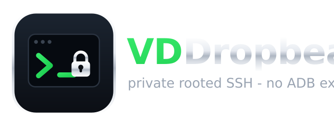
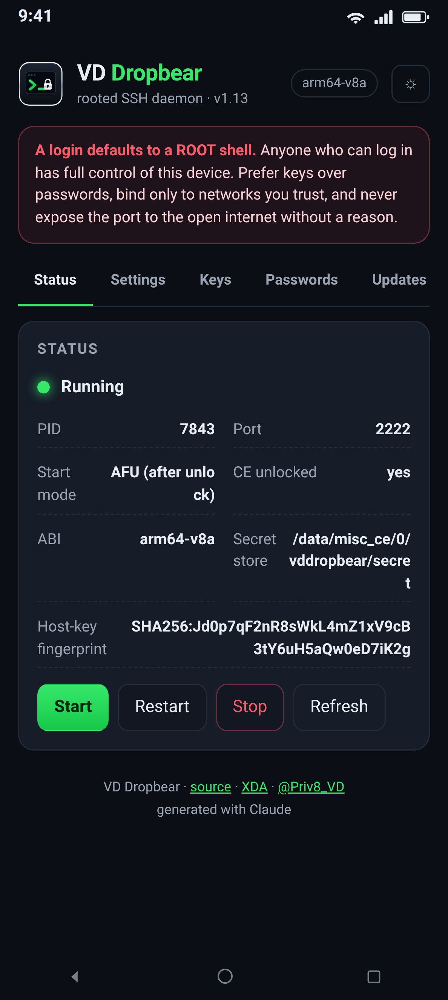
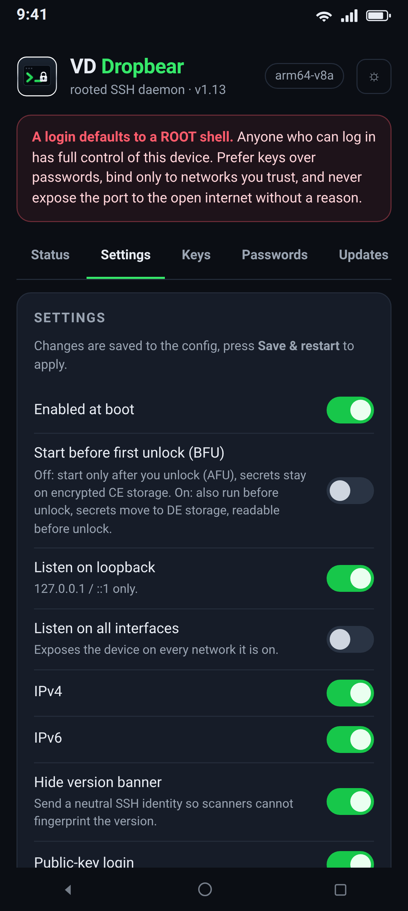
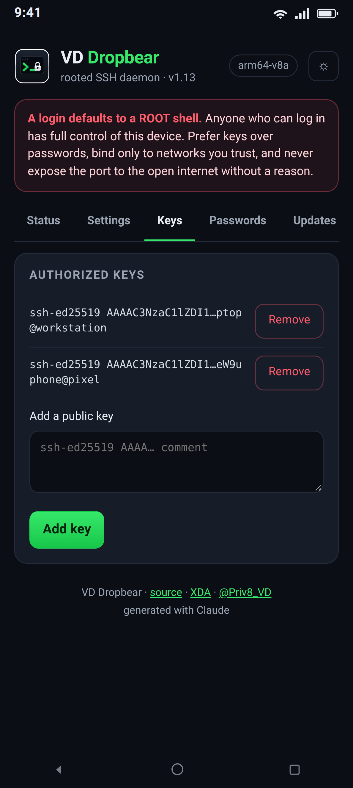
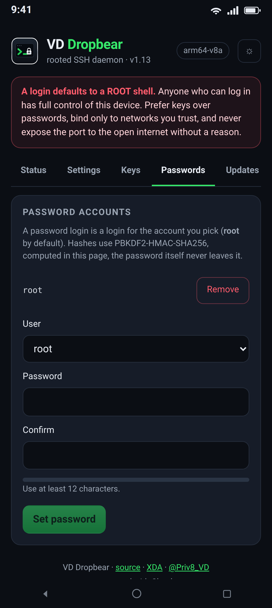

<!--
  ======================================================================
   VD Dropbear  ::  standalone, configurable rooted SSH daemon
   A private SSH server for KernelSU/APatch/Magisk. No invasive ADB exposure.

   Copyright (C) 2026  VD171
   SPDX-License-Identifier: Apache-2.0

   Licensed under the Apache License, Version 2.0; you may obtain a copy at
   http://www.apache.org/licenses/LICENSE-2.0

   Site           : https://vd171.ru
   Site           : https://vd.priv8.ru
   Source         : https://github.com/VD171/VD-dropbear
   GitHub         : @VD171 https://github.com/VD171
   XDA-Developers : @VD171 https://xdaforums.com/m/vd171.4699873/
   XDA thread     : https://xdaforums.com/t/VD-Dropbear.4808524/
   Telegram       : @VD_Priv8 https://t.me/VD_Priv8
   Channel        : @Priv8_VD https://t.me/Priv8_VD
   Discord        : @VD.Priv8 https://discord.com/users/1296831918989639721
   E-mail         : vd.priv8@pm.me
  ======================================================================
-->

  

# VD Dropbear

  
  
  
  

  <a href="https://github.com/VD171/VD-dropbear/releases">Releases</a> ·
  <a href="https://github.com/VD171/VD-dropbear/wiki/nl-Home">Wiki</a> ·
  <a href="https://github.com/VD171/VD-dropbear/wiki/nl-USER-GUIDE">Gebruikershandleiding</a> ·
  <a href="https://github.com/VD171/VD-dropbear/wiki/nl-CONFIGURATION">Configuratie</a> ·
  <a href="https://github.com/VD171/VD-dropbear/wiki/nl-ARCHITECTURE">Architectuur</a> ·
  <a href="https://github.com/VD171/VD-dropbear/wiki/nl-AI-AGENTS">AI-agents</a> ·
  <a href="CHANGELOG.md">Changelog</a> ·
  <a href="https://xdaforums.com/t/VD-Dropbear.4808524/">XDA thread</a>

> **Languages:** [English](README.md) · [العربية](README.ar.md) · [Čeština](README.cs.md) · [Deutsch](README.de.md) · [Español](README.es.md) · [فارسی](README.fa.md) · [Français](README.fr.md) · [हिन्दी](README.hi.md) · [Bahasa Indonesia](README.id.md) · [Italiano](README.it.md) · [日本語](README.ja.md) · [한국어](README.ko.md) · [Nederlands](README.nl.md) · [Polski](README.pl.md) · [Português](README.pt.md) · [Русский](README.ru.md) · [Svenska](README.sv.md) · [ไทย](README.th.md) · [Türkçe](README.tr.md) · [Українська](README.uk.md) · [Tiếng Việt](README.vi.md) · [中文](README.zh.md)

Een **standalone, volledig configureerbare [Dropbear](https://matt.ucc.asn.au/dropbear/) SSH-server**,
verpakt als een KernelSU-/APatch-/Magisk-module. Hij start op eigen kracht en is van geen enkele andere module afhankelijk.

> ⚠️ **Een login geeft standaard een volledige ROOT-shell.** Behandel dit als de sleutels tot
> het toestel: geef de voorkeur aan publieke sleutels boven wachtwoorden en houd de poort weg van het publieke internet.

## Schermafbeeldingen

     

## Waarom

De ingebouwde manier van Android om een shell op je eigen telefoon te krijgen is ADB (USB-debugging), en
dat aanzetten is ingrijpend en verraadt je. `adb_enabled` en `development_settings_enabled` zijn instellingen
die iedereen kan lezen: elke app, SDK of antifraude-/RASP-bibliotheek kan ze uitlezen, de verbinding wordt
gelogd, en er is geen ondersteunde manier om te verbergen dat ADB aan is, of ooit aan is geweest. Die
blootstelling volgt je zelfs op een stock, niet-geroote telefoon: om een shell te krijgen moet je het aankondigen.

VD Dropbear is het private alternatief. Op een geroot toestel geeft het je een echte SSH-server: root-shell,
SFTP en rsync over het netwerk, zonder `adb_enabled`-spoor, zonder USB-debug-vlag, met een versiebanner die
niets prijsgeeft en met inloggegevens die jij beheert. Jouw toegang blijft van jou, in plaats van een
wereldwijd leesbare "ik word gedebugd"-vlag die alles op het toestel kan uitlezen.

## Functies

- **Eén daemon, altijd.** Hij start bij het opstarten en vanaf de **Action**-knop van de manager, en je kunt
  hem op elk moment **starten / stoppen / herstarten** vanuit de WebUI, nooit meer dan één instantie.
- **Alles is configureerbaar** vanuit de WebUI (of `/data/adb/vddropbear/config`):
  - poort, en bind op loopback / all / IPv4 / IPv6 / specifieke adressen
  - **starten vóór de eerste ontgrendeling (BFU) of pas erna (AFU)**, één enkele schakelaar
  - authenticatie met publieke sleutel en/of wachtwoord, maximaal aantal auth-pogingen
  - login-shell, `HOME`, extra environment
  - idle timeout, keepalive, receive window
  - lokale / remote port forwarding en gateway ports (allemaal standaard **uit**)
  - type host-key (ed25519 / rsa / ecdsa)
- **Verborgen versiebanner.** Het SSH-protocol vereist *een* banner, dus die kan niet worden verwijderd, maar
  VD Dropbear vervangt hem door een nietszeggende, zodat scanners de exacte server of versie niet kunnen
  vingerafdrukken en er geen aanvallen voor bekende versies op kunnen richten.
- **Geheimen verstandig opgeslagen** (zie [Beveiligingsmodel](#security-model)).
- **Neem je eigen inloggegevens mee.** Voeg geautoriseerde sleutels en wachtwoordaccounts toe. Een login draait
  als het account waarmee je je authenticeert: standaard **root**, of een Android-account met minder rechten
  (`shell`, `system`). De WebUI dwingt een
  minimale wachtwoordsterkte af en bewaart een wachtwoord nooit in platte tekst.
- **Bestandsoverdracht en synchronisatie ingebouwd.** De bundel bevat `sftp-server`, `scp` en `rsync`, zodat
  SFTP, sshfs, GUI-clients en back-ups allemaal over dezelfde verbinding werken.
- **SSH via USB, zonder ADB.** Zet USB-tethering aan en bind de daemon aan het USB-adres: dezelfde sessie via de kabel, sneller en stabieler dan wifi voor grote overdrachten.
- **Elk toestel en elke emulator.** `arm64-v8a`, `armeabi-v7a`, `x86`, `x86_64`.

## AI-agents

Een permanent SSH-eindpunt maakt van je telefoon iets wat een **autonome AI-agent rechtstreeks kan bedienen**.
Elke agent die een shell of SSH-verbinding kan aansturen (Claude Code, aider, een script met een LLM in de lus,
je eigen automatisering) krijgt een echte root-sessie op het toestel, over het netwerk, zonder USB-kabel en
zonder een van ADB's zelfverradende debugvlaggen. De agent ziet een normale Linux-achtige shell en kan:

- bestanden lezen en bewerken, instellingen omzetten, en modules, pakketten en services beheren;
- logs triëren, artefacten ophalen en op aanvraag diagnostiek of forensisch onderzoek uitvoeren;
- bestanden beide kanten op verplaatsen en synchroniseren via `scp` / `sftp` / `rsync`, voor back-ups, migraties of provisioning;
- een hele vloot geroote toestellen vanaf één plek aansturen, elk bereikbaar met zijn eigen sleutel.

Omdat het project **AI-vriendelijk** is gebouwd (een gedocumenteerd configuratiebestand, een expliciet
runtime-[env-contract](patches/README.md), voorspelbare paden en status in platte tekst), kan een agent
ontdekken hoe hij het gebruikt zonder te gissen.

> **Standaard root, dus behandel het als root.** Een standaardlogin komt binnen als root, en je kunt je ook
> aanmelden met een account met minder rechten (`shell`, `system`), zie de
> waarschuwing hieronder. Wanneer je toegang aan een agent geeft, geef hem zijn eigen inloggegevens (niet je
> persoonlijke sleutel), wijs hem naar een account met minder rechten zoals `shell` als je zijn bereik wilt
> beperken, beperk de binds tot de netwerken die je vertrouwt (loopback of een VPN in plaats van het open internet), houd
> wachtwoordauthenticatie uit, en onthoud dat je op elk moment vanuit de WebUI een sleutel kunt intrekken of de
> daemon kunt stoppen.

## Installatie

Flash de module-zip in de KernelSU-, APatch- of Magisk-manager (of vanaf de opdrachtregel met
`ksud module install` / `apd module install`), open de **WebUI** van de module om de poort in te stellen en je
sleutels toe te voegen, en start daarna opnieuw op (of druk op **Action** om hem nu te starten).

## Beveiliging

### Waar geheimen leven: BFU vs AFU

`/data/adb` is **device-encrypted (DE)** opslag: het wordt ontsleuteld *voordat* de gebruiker de telefoon
ontgrendelt (Before First Unlock), dus alles daar is vóór ontgrendeling leesbaar. `/data/misc_ce` is
**credential-encrypted (CE)**: Android houdt het versleuteld totdat de gebruiker ontgrendelt (After First Unlock).

- **AFU-modus (standaard, `START_IN_BFU=0`):** de daemon wacht op ontgrendeling en leest zijn host key,
  `authorized_keys` en wachtwoord-hashes uit CE-opslag. Maximale bescherming, SSH werkt pas nadat het toestel
  sinds het opstarten één keer is ontgrendeld.
- **BFU-modus (`START_IN_BFU=1`):** de daemon start vóór ontgrendeling zodat je vroeg via SSH kunt inloggen
  (bijvoorbeeld om het toestel op afstand te ontgrendelen). Zijn geheimen staan dan op DE-opslag en zijn vóór
  ontgrendeling leesbaar, een bewuste en gedocumenteerde afweging. Schakel het alleen in als je SSH vóór
  ontgrendeling nodig hebt.

We voegen bewust **geen** eigen versleuteling bovenop CE toe: het is al versleuteld met de inloggegevens van de
gebruiker, en er nog een cijfer overheen leggen zou een sleutel vereisen die ergens moet staan (op DE zou die
worden blootgesteld, hem afleiden uit de inloggegevens van de gebruiker is slechts CE opnieuw implementeren). Dat
koopt een vals gevoel van veiligheid, geen echte bescherming.

### Wachtwoorden

Inloggen met wachtwoord staat **standaard uit**, omdat een login standaard root is en sleutels veel veiliger zijn. Wanneer
je wel een wachtwoord instelt, dwingt de WebUI een minimale sterkte af en bewaart alleen een hash, nooit platte tekst.

## Build

Het serverbinaire wordt door CI gebouwd uit **upstream [mkj/dropbear](https://github.com/mkj/dropbear)** met een
kleine, controleerbare set patches (zie [`patches/`](patches/)): een neutrale/configureerbare identiteitsstring,
config-gestuurde paden voor `authorized_keys` en het wachtwoordbestand, en de Android-`openpty`-fix voor
interactieve PTY's. Een geplande workflow volgt upstream en bouwt opnieuw, zodat de module actueel blijft. Zie
[`.github/workflows/`](.github/workflows/) en [`CONTRIBUTING.md`](CONTRIBUTING.md).

## Incrementele updates (VDLU)

VD Dropbear levert de **[VDLiveUpdate](https://github.com/VD171/VDLiveUpdate) (VDLU)**-engine mee (ingebed in `vdlu/`): de module werkt zichzelf bij door alleen de gewijzigde bestanden op te halen (inhoudsgeadresseerde blobs + een ondertekende `manifest.json`), in plaats van de hele `.zip` opnieuw te downloaden. **Hardened**-profiel: de ed25519-handtekening is verplicht en downgrades worden geblokkeerd, de volledige `.zip` blijft geldig als fallback.

- **Alleen LIVE** (geen reboot): updates worden toegepast bij de volgende boot via `service.sh` (`setsid`, op de achtergrond, blokkeert de boot nooit), een no-op wanneer geen enkele feed bereikbaar is.
- **Status** in `/data/adb/<module>/vdlu/`, buiten de module, zodat die een reflash overleeft.
- **WebUI:** een **Updates**-paneel met een voortgangstoast en annuleren, automatisch bijwerken is opt-in.

## Documentatie

<!-- vd-docs -->
- **[Wiki](https://github.com/VD171/VD-dropbear/wiki/nl-Home)**: de volledige documentatie, online te doorbladeren.
- **[Gebruikershandleiding](https://github.com/VD171/VD-dropbear/wiki/nl-USER-GUIDE)**: installatie, sleutels, wachtwoorden, verbinden, bestandsoverdracht, BFU/AFU.
- **[Configuratie](https://github.com/VD171/VD-dropbear/wiki/nl-CONFIGURATION)**: elke instelling, met standaardwaarden.
- **[Architectuur](https://github.com/VD171/VD-dropbear/wiki/nl-ARCHITECTURE)** en **[Bestandsstructuur](https://github.com/VD171/VD-dropbear/wiki/nl-FILE-STRUCTURE)**: hoe de module en de daemon werken, en waar alles staat.
- **[AI-agents](https://github.com/VD171/VD-dropbear/wiki/nl-AI-AGENTS)**: een autonome agent veilig gebruiken via SSH.
- **[Bouwen](https://github.com/VD171/VD-dropbear/wiki/nl-BUILDING)**: de build en het verhaal van crypt()/cross-compileren op Android.
- **[Bijdragen](CONTRIBUTING.md)** en **[Beveiliging](SECURITY.md)**.
- **[Changelog](CHANGELOG.md)** en **[Gedragscode](CODE_OF_CONDUCT.md)**.

Elke wikipagina is ook vertaald naar elke taal in de schakelaar hierboven, dezelfde bronnen staan onder [`docs/`](docs/).
<!-- /vd-docs -->

## Zie ook

- **[COPG-VD](https://github.com/VD171/COPG-VD)**: globale device-fingerprint-/Play-Integrity-spoofing, voor het hele toestel met bereik per app en een WebUI.
- **[VDBackup](https://github.com/VD171/VD-Backup)**: volledige back-up en herstel van apps en gegevens als root, volledig aangestuurd vanuit een WebUI.
- **[VDGoogle](https://github.com/VD171/VD-Google)**: je Google-diensten (RCS, Wallet, Play Integrity-attestaties), gelezen op je toestel zonder internet.
- **[VDInstaller](https://github.com/VD171/VD-Installer)**: een wrijvingsloze root-sideload-installer voor losse, batch- en split-APK's, met een Play Protect-verifier-schakelaar en vervalsing van de installatiebron.
- **[VDInfos](https://github.com/VD171/VD-Infos)**: een apparaat-methodedebugger die elk item leest via elke methode die het kan lezen en ze naast elkaar vergelijkt.
- **[VDLiveUpdate](https://github.com/VD171/VDLiveUpdate)**: een flashloze, incrementele zelfupdate-engine, ingebed in KernelSU/APatch/Magisk-modules.
- **[VD-Modules](https://github.com/VD171/VD-Modules)**: onze module-repository voor MMRL/WebUI-X (installeer ze allemaal vanuit je root-manager).
- **[@VictorGabriel7Dev/build.prop](https://github.com/VictorGabriel7Dev/build.prop)**: een dataset van Pixel-`build.prop`-fingerprints (fork van @T3SL4).
- **[@VictorGabriel7Dev/mtproto-store](https://github.com/VictorGabriel7Dev/mtproto-store)**: gebruik Telegram als objectopslag vanuit een kleine Go-CLI.

## Contacten

- https://vd171.ru
- https://vd.priv8.ru
- **Telegram:** @VD_Priv8 https://t.me/VD_Priv8
- **Channel:** @Priv8_VD https://t.me/Priv8_VD
- **Discord:** @VD.Priv8 https://discord.com/users/1296831918989639721
- **E-mail:** vd.priv8@pm.me
- **XDA-Developers:** @VD171 https://xdaforums.com/m/vd171.4699873/
- **XDA thread:** https://xdaforums.com/t/VD-Dropbear.4808524/
- **GitHub:** @VD171 https://github.com/VD171

## Licentie

De eigen code van VD Dropbear is **Apache-2.0**, zie [LICENSE](LICENSE). De module bundelt ook binaries van
derden: [Dropbear](https://matt.ucc.asn.au/dropbear/) (MIT-stijl), OpenSSH's `sftp-server` en `scp` (BSD), en
`rsync` (GPL-3.0), elk onder zijn eigen licentie, zie [THIRD-PARTY-NOTICES.md](THIRD-PARTY-NOTICES.md), inclusief
hoe we voor rsync aan de GPL voldoen. Onze Apache-2.0-code blijft hierdoor onaangetast (de GPL-binary wordt enkel
geaggregeerd, niet gelinkt).

## Handelsmerken

VD Dropbear is een onafhankelijk, niet-officieel project, niet gelieerd aan of onderschreven door enige derde
partij. "Android" is een handelsmerk van Google LLC. "SSH" is een geregistreerd handelsmerk van SSH Communications
Security. VD Dropbear draait volledig op je toestel.

## Tags

`SSH` `Dropbear` `KernelSU` `Magisk` `APatch` `root` `sshd` `remote-access` `openssh-alternative` `Android` `BFU` `VD-dropbear`

---

📣 **Word lid van het kanaal voor updates:** @Priv8_VD https://t.me/Priv8_VD
