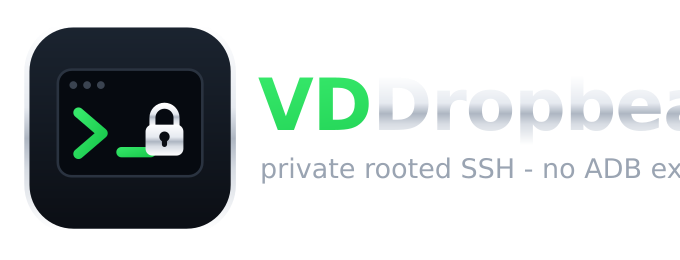

<!--
  ======================================================================
   VD Dropbear  ::  standalone, configurable rooted SSH daemon
   A private SSH server for KernelSU/APatch/Magisk - no invasive ADB exposure.

   Copyright (C) 2026  VD171
   SPDX-License-Identifier: Apache-2.0

   Licensed under the Apache License, Version 2.0; you may obtain a copy at
   http://www.apache.org/licenses/LICENSE-2.0

   Site           : https://vd171.ru
   Site           : https://vd.priv8.ru
   Source         : https://github.com/VD171/VD-dropbear
   GitHub         : @VD171 https://github.com/VD171
   XDA-Developers : @VD171 https://xdaforums.com/m/vd171.4699873/
   XDA thread     : https://xdaforums.com/t/VD-Dropbear.4808524/
   Telegram       : @VD_Priv8 https://t.me/VD_Priv8
   Channel        : @Priv8_VD https://t.me/Priv8_VD
   Discord        : @VD.Priv8 https://discord.com/users/1296831918989639721
   E-mail         : vd.priv8@pm.me
  ======================================================================
-->

  

# VD Dropbear

  
  
  
  
  
  

**En fristående, helt konfigurerbar [Dropbear](https://matt.ucc.asn.au/dropbear/) SSH-server**
paketerad som en KernelSU- / APatch- / Magisk-modul. Den startar på egen hand och är inte beroende av någon annan modul.

> ⚠️ **Varje anslutning som autentiseras får ett ROOT-skal.** Behandla det som nycklarna till
> enheten: föredra publika nycklar framför lösenord och håll porten borta från det öppna internet.

Languages: English · [العربية](README.ar.md) · [Čeština](README.cs.md) · [Deutsch](README.de.md) · [Español](README.es.md) · [فارسی](README.fa.md) · [Français](README.fr.md) · [हिन्दी](README.hi.md) · [Bahasa](README.in.md) · [Italiano](README.it.md) · [日本語](README.ja.md) · [한국어](README.ko.md) · [Nederlands](README.nl.md) · [Polski](README.pl.md) · [Português](README.pt.md) · [Русский](README.ru.md) · [Svenska](README.sv.md) · [ไทย](README.th.md) · [Türkçe](README.tr.md) · [Українська](README.uk.md) · [Tiếng Việt](README.vi.md) · [中文](README.zh.md)

## Varför

Androids inbyggda sätt att få ett skal på din egen telefon är ADB (USB-felsökning), och att slå på
det är påträngande och avslöjar dig själv. `adb_enabled` och `development_settings_enabled` är
inställningar som alla kan läsa - vilken app, SDK eller bedrägeri- / RASP-bibliotek som helst kan
läsa dem, anslutningen loggas, och det finns inget understött sätt att dölja att ADB är, eller
någonsin har varit, påslaget. Exponeringen följer med dig även på en orörd telefon utan root: för
att få ett skal måste du tillkännage det.

VD Dropbear är det privata alternativet. På en enhet med root ger den dig en riktig SSH-server -
root-skal, SFTP och rsync över nätverket - utan att `adb_enabled` avslöjar något, utan flagga för
USB-felsökning, med en versionsbanner som inte röjer något, och med inloggningsuppgifter som du
styr över. Din åtkomst förblir din, i stället för en globalt läsbar flagga av typen "jag felsöks"
som vad som helst på enheten kan läsa.

## Funktioner

- **En daemon, alltid.** Den startar vid uppstart och från hanterarens **Action**-knapp, och du
  kan när som helst **starta / stoppa / starta om** den från WebUI:et; aldrig mer än en instans.
- **Allt är konfigurerbart** från WebUI:et (eller `/data/adb/vddropbear/config`):
  - port, och bindning till loopback / alla / IPv4 / IPv6 / specifika adresser
  - **starta före första upplåsningen (BFU) eller först efter den (AFU)** - en enda växel
  - autentisering med publik nyckel och/eller lösenord, max antal autentiseringsförsök
  - inloggningsanvändare, shell, `HOME`, extra miljövariabler
  - tidsgräns vid inaktivitet, keepalive, mottagningsfönster
  - lokal / fjärr-portvidarebefordran och gateway-portar (allt **avstängt** som standard)
  - typ av värdnyckel (ed25519 / rsa / ecdsa)
- **Dold versionsbanner.** SSH-protokollet kräver *en* banner, så den kan inte tas bort, men VD
  Dropbear byter ut den mot en intetsägande, så att skannrar inte kan fingeravtrycka exakt vilken
  server eller version det är och rikta kända versionsangrepp mot den.
- **Hemligheter lagras förnuftigt** (se [Säkerhetsmodell](#security-model)).
- **Ta med egna inloggningsuppgifter.** Lägg till uppsättningar av `user + key` och
  `user + password`; WebUI:et kräver en lägsta lösenordsstyrka och lagrar aldrig ett lösenord i klartext.
- **Filöverföring och synkning inbyggt.** Paketet innehåller `sftp-server`, `scp` och `rsync`, så
  SFTP, sshfs, grafiska klienter och säkerhetskopior fungerar alla över samma anslutning.
- **Varje enhet och emulator.** `arm64-v8a`, `armeabi-v7a`, `x86`, `x86_64`.

## AI-agenter på din enhet

En stående SSH-ändpunkt gör din telefon till något som en **autonom AI-agent kan styra direkt**.
Vilken agent som helst som kan driva ett skal eller en SSH-anslutning - Claude Code, aider, ett
skript med en LLM i loopen, din egen automatisering - får en riktig root-session på enheten, över
nätverket, utan USB-sladd och utan ADB:s självavslöjande felsökningsflaggor. Agenten ser ett vanligt
Linux-liknande skal och kan:

- läsa och redigera filer, ändra inställningar och hantera moduler, paket och tjänster;
- sålla i loggar, hämta artefakter och köra diagnostik eller forensik på begäran;
- flytta och synka filer åt båda håll via `scp` / `sftp` / `rsync`, för säkerhetskopior, migreringar eller provisionering;
- styra en hel flotta av enheter med root från ett enda ställe, där var och en nås med sin egen nyckel.

Eftersom projektet är byggt för att vara **AI-vänligt** - en dokumenterad konfigurationsfil, ett
uttryckligt [miljökontrakt](patches/README.md) vid körning, förutsägbara sökvägar och status i
klartext - kan en agent själv komma underfund med hur den används, utan gissningar.

> **Det här är root, så behandla det som root.** Varje autentiserad anslutning landar som root (se
> varningen nedan). När du överlämnar åtkomst till en agent, ge den en **egen användare och nyckel**,
> begränsa bindningarna till de nätverk du litar på (loopback eller ett VPN snarare än det öppna
> internet), håll lösenordsautentisering avstängd och kom ihåg att du när som helst kan återkalla en
> nyckel eller stoppa daemonen från WebUI:et.

## Installation

Flasha modulens zip i KernelSU-, APatch- eller Magisk-hanteraren (eller från kommandoraden med
`ksud module install` / `apd module install`), öppna modulens **WebUI** för att ställa in porten och
lägga till dina nycklar, och starta sedan om (eller tryck på **Action** för att starta den nu).

## Säkerhetsmodell

### Var hemligheterna bor: BFU kontra AFU

`/data/adb` är lagring med **enhetskryptering (DE)**: den dekrypteras *innan* användaren låser upp
telefonen (Before First Unlock), så allt där är läsbart innan upplåsning. `/data/misc_ce` har
**autentiseringskryptering (CE)**: Android håller det krypterat tills användaren låser upp (After
First Unlock).

- **AFU-läge (standard, `START_IN_BFU=0`):** daemonen väntar på upplåsning och läser sin värdnyckel,
  `authorized_keys` och lösenordshashar från CE-lagringen. Maximalt skydd; SSH fungerar först efter
  att enheten har låsts upp en gång sedan uppstart.
- **BFU-läge (`START_IN_BFU=1`):** daemonen startar före upplåsning så att du kan ansluta via SSH
  tidigt (till exempel för att låsa upp enheten på distans). Dess hemligheter bor då på DE-lagringen
  och är läsbara innan upplåsning, en medveten och dokumenterad avvägning. Aktivera det bara om du
  behöver SSH innan upplåsning.

Vi lägger medvetet **inte** till vår egen kryptering ovanpå CE: det är redan krypterat med
användarens inloggningsuppgift, och att lägga på ännu ett chiffer skulle kräva en nyckel som måste
bo någonstans (på DE skulle den vara exponerad; att härleda den ur användarens inloggningsuppgift är
bara att återimplementera CE). Det skulle ge en falsk känsla av säkerhet, inte verkligt skydd.

### Lösenord

Lösenordsinloggning är **avstängd som standard**, eftersom varje inloggning är root och nycklar är
långt mycket säkrare. När du väl sätter ett lösenord kräver WebUI:et en lägsta styrka och lagrar bara
en hash, aldrig klartext.

## Bygge

Serverbinären byggs av CI från **uppströms [mkj/dropbear](https://github.com/mkj/dropbear)** med en
liten, granskningsbar uppsättning patchar (se [`patches/`](patches/)): en neutral/konfigurerbar
identitetssträng, konfigurationsstyrda sökvägar för `authorized_keys` och lösenordsfilen, samt
Android-fixen för `openpty` för interaktiva PTY:er. Ett schemalagt arbetsflöde följer uppströms och
bygger om, så att modulen hålls aktuell. Se [`.github/workflows/`](.github/workflows/) och
[`CONTRIBUTING.md`](CONTRIBUTING.md).

## Dokumentation

<!-- vd-docs -->
Den fullständiga dokumentationen finns i [wikin](https://github.com/VD171/VD-dropbear/wiki) och under
[`docs/`](docs/).
<!-- /vd-docs -->

## Se även

Systerprojekt av samma upphovsperson:

- **[VDInfos](https://github.com/VD171/VD-Infos)**: en felsökare för enhetens metoder som läser varje post genom varje metod som kan läsa den och jämför dem sida vid sida.
- **[VDGoogle](https://github.com/VD171/VD-Google)**: dina Google-tjänster (RCS, Wallet, Play Integrity-attesteringar), lästa på din enhet utan internet.
- **[VDBackup](https://github.com/VD171/VD-Backup)**: fullständig säkerhetskopiering och återställning av appar och data som root, helt styrd från ett WebUI.
- **[COPG-VD](https://github.com/VD171/COPG-VD)**: en global förfalskare av enhetens fingeravtryck och build-egenskaper.

## Kontakter

* https://vd171.ru
* https://vd.priv8.ru
* **Telegram:** @VD_Priv8 https://t.me/VD_Priv8
* **Kanal:** @Priv8_VD https://t.me/Priv8_VD
* **Discord:** @VD.Priv8 https://discord.com/users/1296831918989639721
* **E-post:** vd.priv8@pm.me
* **XDA-Developers:** @VD171 https://xdaforums.com/m/vd171.4699873/
* **XDA-tråd:** _(platshållare - läggs till vid första publika släppet)_
* **GitHub:** @VD171 https://github.com/VD171

## Licens

VD Dropbears egen kod är **Apache-2.0** - se [LICENSE](LICENSE). Modulen paketerar även
tredjepartsbinärer - [Dropbear](https://matt.ucc.asn.au/dropbear/) (MIT-liknande), OpenSSH:s
`sftp-server` och `scp` (BSD), samt `rsync` (GPL-3.0) - var och en under sin egen licens; se
[THIRD-PARTY-NOTICES.md](THIRD-PARTY-NOTICES.md), inklusive hur vi följer GPL för rsync. Vår
Apache-2.0-kod påverkas inte (GPL-binären är bara aggregerad, inte länkad).

## Varumärken

VD Dropbear är ett oberoende, inofficiellt projekt, inte knutet till eller godkänt av någon tredje
part. "Android" är ett varumärke som tillhör Google LLC; "SSH" är ett registrerat varumärke som
tillhör SSH Communications Security. VD Dropbear körs helt och hållet på din enhet.

## Tags

`SSH` `Dropbear` `KernelSU` `Magisk` `APatch` `root` `sshd` `remote-access` `openssh-alternative` `Android` `BFU` `VD-dropbear`
