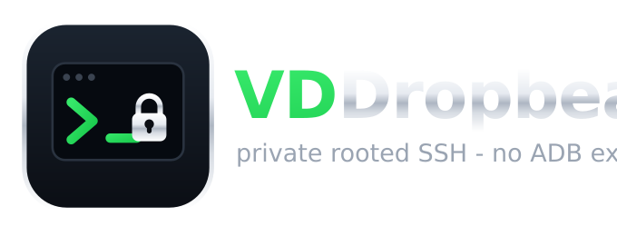
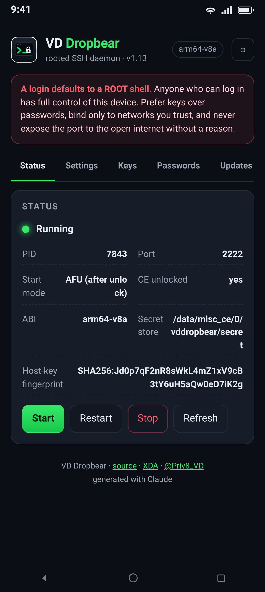
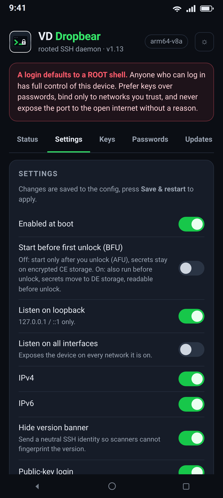
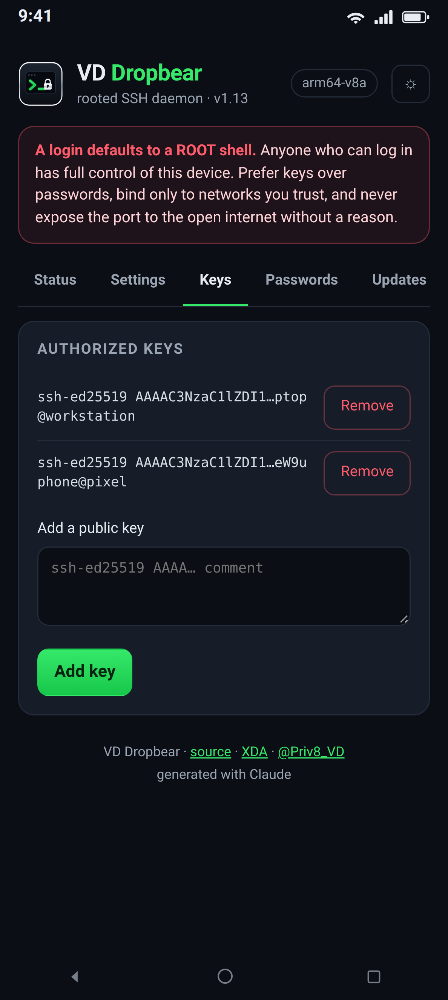
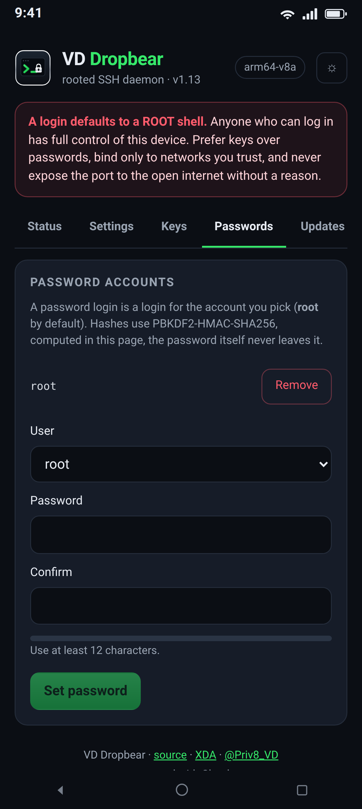

<!--
  ======================================================================
   VD Dropbear  ::  standalone, configurable rooted SSH daemon
   A private SSH server for KernelSU/APatch/Magisk. No invasive ADB exposure.

   Copyright (C) 2026  VD171
   SPDX-License-Identifier: Apache-2.0

   Licensed under the Apache License, Version 2.0; you may obtain a copy at
   http://www.apache.org/licenses/LICENSE-2.0

   Site           : https://vd171.ru
   Site           : https://vd.priv8.ru
   Source         : https://github.com/VD171/VD-dropbear
   GitHub         : @VD171 https://github.com/VD171
   XDA-Developers : @VD171 https://xdaforums.com/m/vd171.4699873/
   XDA thread     : https://xdaforums.com/t/VD-Dropbear.4808524/
   Telegram       : @VD_Priv8 https://t.me/VD_Priv8
   Channel        : @Priv8_VD https://t.me/Priv8_VD
   Discord        : @VD.Priv8 https://discord.com/users/1296831918989639721
   E-mail         : vd.priv8@pm.me
  ======================================================================
-->

  

# VD Dropbear

  
  
  
  

  <a href="https://github.com/VD171/VD-dropbear/releases">Releases</a> ·
  <a href="https://github.com/VD171/VD-dropbear/wiki/th-Home">Wiki</a> ·
  <a href="https://github.com/VD171/VD-dropbear/wiki/th-USER-GUIDE">คู่มือผู้ใช้</a> ·
  <a href="https://github.com/VD171/VD-dropbear/wiki/th-CONFIGURATION">การตั้งค่า</a> ·
  <a href="https://github.com/VD171/VD-dropbear/wiki/th-ARCHITECTURE">สถาปัตยกรรม</a> ·
  <a href="https://github.com/VD171/VD-dropbear/wiki/th-AI-AGENTS">เอเจนต์ AI</a> ·
  <a href="CHANGELOG.md">Changelog</a> ·
  <a href="https://xdaforums.com/t/VD-Dropbear.4808524/">XDA thread</a>

> **Languages:** [English](README.md) · [العربية](README.ar.md) · [Čeština](README.cs.md) · [Deutsch](README.de.md) · [Español](README.es.md) · [فارسی](README.fa.md) · [Français](README.fr.md) · [हिन्दी](README.hi.md) · [Bahasa Indonesia](README.id.md) · [Italiano](README.it.md) · [日本語](README.ja.md) · [한국어](README.ko.md) · [Nederlands](README.nl.md) · [Polski](README.pl.md) · [Português](README.pt.md) · [Русский](README.ru.md) · [Svenska](README.sv.md) · [ไทย](README.th.md) · [Türkçe](README.tr.md) · [Українська](README.uk.md) · [Tiếng Việt](README.vi.md) · [中文](README.zh.md)

**เซิร์ฟเวอร์ SSH [Dropbear](https://matt.ucc.asn.au/dropbear/) ที่ทำงานได้ด้วยตัวเองและปรับแต่งได้ทั้งหมด**
แพ็กมาเป็นโมดูล KernelSU / APatch / Magisk มันเริ่มทำงานได้ด้วยตัวเองและไม่ต้องพึ่งโมดูลอื่นใด

> ⚠️ **การเข้าสู่ระบบจะได้ ROOT shell เต็มรูปแบบโดยค่าเริ่มต้น** ให้ปฏิบัติกับมันเหมือนเป็นกุญแจของเครื่อง:
> เลือกใช้คีย์สาธารณะแทนรหัสผ่าน และอย่าเปิดพอร์ตนี้ออกสู่อินเทอร์เน็ตสาธารณะ

## ภาพหน้าจอ

     

## ทำไม

วิธีในตัวของ Android ที่จะเข้าถึง shell บนโทรศัพท์ของคุณเองคือ ADB (การดีบักผ่าน USB) และการเปิดใช้งานมัน
ทั้งล่วงล้ำและเปิดเผยตัวเอง `adb_enabled` และ `development_settings_enabled` เป็นการตั้งค่าที่ใครก็อ่านได้:
แอป, SDK หรือไลบรารีป้องกันการฉ้อโกง / RASP ใดก็ตามสามารถอ่านมันได้ การเชื่อมต่อถูกบันทึกไว้ และไม่มีวิธีที่
รองรับใด ๆ ที่จะซ่อนว่า ADB กำลังเปิดอยู่หรือเคยเปิดมาก่อน การเปิดเผยนี้ติดตามคุณไปแม้บนโทรศัพท์ที่เป็นสต็อก
และยังไม่รูท: เพื่อให้ได้ shell คุณต้องประกาศมันออกไป

VD Dropbear คือทางเลือกที่เป็นส่วนตัว บนเครื่องที่รูทแล้ว มันมอบเซิร์ฟเวอร์ SSH ที่แท้จริงให้คุณ: root shell,
SFTP และ rsync ผ่านเครือข่าย โดยไม่มีร่องรอย `adb_enabled`, ไม่มีแฟล็กการดีบักผ่าน USB, แบนเนอร์เวอร์ชัน
ที่ไม่เผยอะไรเลย และข้อมูลประจำตัวที่คุณควบคุมเอง การเข้าถึงของคุณยังคงเป็นของคุณ แทนที่จะเป็นแฟล็ก "ฉันกำลัง
ถูกดีบัก" ที่อ่านได้ทั่วทั้งระบบและสิ่งใดก็ตามบนเครื่องสามารถอ่านได้

## คุณสมบัติ

- **มีเดมอนเดียวเสมอ** มันเริ่มทำงานตอนบูตและจากปุ่ม **Action** ของตัวจัดการ และคุณสามารถ
  **เริ่ม / หยุด / รีสตาร์ต** มันได้จาก WebUI ตลอดเวลา, ไม่มีทางเกินหนึ่งอินสแตนซ์
- **ทุกอย่างปรับแต่งได้** จาก WebUI (หรือ `/data/adb/vddropbear/config`):
  - พอร์ต และการผูกกับ loopback / ทั้งหมด / IPv4 / IPv6 / ที่อยู่เฉพาะ
  - **เริ่มก่อนการปลดล็อกครั้งแรก (BFU) หรือเฉพาะหลังจากนั้น (AFU)** สวิตช์เดียวจบ
  - การยืนยันตัวตนด้วยคีย์สาธารณะและ/หรือรหัสผ่าน, จำนวนครั้งสูงสุดในการยืนยันตัวตน
  - shell สำหรับเข้าสู่ระบบ, `HOME`, ตัวแปรสภาพแวดล้อมเพิ่มเติม
  - เวลาหมดอายุเมื่อไม่มีการใช้งาน, keepalive, หน้าต่างรับข้อมูล
  - การส่งต่อพอร์ตแบบโลคัล / รีโมต และ gateway ports (ทั้งหมด**ปิด**ไว้โดยค่าเริ่มต้น)
  - ชนิดของ host-key (ed25519 / rsa / ecdsa)
- **แบนเนอร์เวอร์ชันที่ถูกซ่อน** โปรโตคอล SSH กำหนดให้ต้องมีแบนเนอร์*สักอัน* จึงลบทิ้งไม่ได้ แต่ VD Dropbear
  แทนที่มันด้วยแบนเนอร์ที่ไม่ให้ข้อมูลใด ๆ เพื่อให้ตัวสแกนไม่สามารถระบุได้ว่าเป็นเซิร์ฟเวอร์หรือเวอร์ชันใดกันแน่
  แล้วเล็งการโจมตีที่เจาะจงเวอร์ชันมาที่มัน
- **เก็บความลับอย่างสมเหตุสมผล** (ดู[โมเดลความปลอดภัย](#security-model))
- **นำข้อมูลประจำตัวของคุณเองมาใช้** เพิ่มคีย์ที่ได้รับอนุญาตและบัญชีที่ใช้รหัสผ่าน การเข้าสู่ระบบจะทำงานในฐานะ
  บัญชีที่คุณใช้ยืนยันตัวตน: เป็น **root** โดยค่าเริ่มต้น หรือบัญชี Android ที่มีสิทธิ์ต่ำกว่า (`shell`, `system`)
  WebUI บังคับความแข็งแรง
  ขั้นต่ำของรหัสผ่าน และไม่เคยเก็บรหัสผ่านเป็นข้อความธรรมดา
- **มีการถ่ายโอนและซิงค์ไฟล์มาให้ในตัว** ชุดนี้มาพร้อม `sftp-server`, `scp` และ `rsync` ดังนั้น SFTP, sshfs,
- **SSH ผ่าน USB ไม่ใช้ ADB** เปิดการแชร์เน็ตผ่าน USB แล้วผูกเดมอนกับที่อยู่ USB: เซสชันเดียวกันผ่านสาย เร็วและนิ่งกว่าการไร้สายสำหรับการถ่ายโอนไฟล์ใหญ่
  ไคลเอนต์แบบ GUI และการสำรองข้อมูลทั้งหมดจึงทำงานผ่านการเชื่อมต่อเดียวกันได้
- **ทุกเครื่องและทุกอีมูเลเตอร์** `arm64-v8a`, `armeabi-v7a`, `x86`, `x86_64`

## เอเจนต์ AI

จุดปลาย SSH ที่เปิดค้างไว้เปลี่ยนโทรศัพท์ของคุณให้กลายเป็นสิ่งที่ **เอเจนต์ AI อิสระสามารถควบคุมได้โดยตรง**
เอเจนต์ใดก็ตามที่สามารถขับเคลื่อน shell หรือการเชื่อมต่อ SSH ได้ (Claude Code, aider, สคริปต์ที่มี LLM อยู่
ในลูป, ระบบอัตโนมัติของคุณเอง) จะได้เซสชัน root จริงบนเครื่องผ่านเครือข่าย โดยไม่ต้องต่อสาย USB และไม่มีแฟล็ก
การดีบักที่เปิดเผยตัวเองของ ADB เลย เอเจนต์จะเห็น shell ที่คล้าย Linux ตามปกติ และสามารถ:

- อ่านและแก้ไขไฟล์, สลับการตั้งค่า และจัดการโมดูล, แพ็กเกจ และบริการต่าง ๆ;
- คัดกรองล็อก, ดึงอาร์ติแฟกต์ และรันการวินิจฉัยหรือการพิสูจน์หลักฐานเมื่อต้องการ;
- ย้ายและซิงค์ไฟล์ทั้งสองทิศทางผ่าน `scp` / `sftp` / `rsync` สำหรับการสำรองข้อมูล, การย้ายข้อมูล หรือการตั้งค่าเริ่มต้น;
- ขับเคลื่อนฝูงเครื่องที่รูทแล้วทั้งหมดจากที่เดียว โดยแต่ละเครื่องเข้าถึงได้ด้วยคีย์ของตัวเอง

เนื่องจากโปรเจกต์นี้ถูกสร้างมาให้ **เป็นมิตรกับ AI** (ไฟล์การตั้งค่าที่มีเอกสารกำกับ, [สัญญาด้านสภาพแวดล้อม](patches/README.md)
ขณะทำงานที่ชัดเจน, เส้นทางที่คาดเดาได้ และสถานะแบบข้อความธรรมดา) เอเจนต์จึงสามารถค้นพบวิธีใช้งานมันได้เองโดย
ไม่ต้องเดา

> **เป็น root โดยค่าเริ่มต้น ดังนั้นจงปฏิบัติกับมันเหมือน root** การเข้าสู่ระบบโดยค่าเริ่มต้นจะเข้ามาในฐานะ root
> และคุณยังเข้าสู่ระบบด้วยบัญชีที่มีสิทธิ์ต่ำกว่า (`shell`, `system`) ได้ด้วย (ดูคำเตือนด้านล่าง) เมื่อคุณมอบการเข้าถึง
> ให้เอเจนต์ ให้มอบข้อมูลประจำตัวของมันเอง (ไม่ใช่คีย์ส่วนตัวของคุณ) หากต้องการจำกัดขอบเขตของมัน ให้ชี้มันไปยัง
> บัญชีที่มีสิทธิ์ต่ำกว่าอย่าง `shell`, จำกัดการผูกไว้
> เฉพาะเครือข่ายที่คุณไว้ใจ (loopback หรือ VPN แทนที่จะเป็นอินเทอร์เน็ตเปิด), ปิดการยืนยันตัวตนด้วยรหัสผ่านไว้
> และจำไว้ว่าคุณสามารถเพิกถอนคีย์หรือหยุดเดมอนได้ทุกเมื่อจาก WebUI

## การติดตั้ง

แฟลช zip ของโมดูลในตัวจัดการ KernelSU, APatch หรือ Magisk (หรือจากบรรทัดคำสั่งด้วย
`ksud module install` / `apd module install`), เปิด **WebUI** ของโมดูลเพื่อตั้งค่าพอร์ตและเพิ่มคีย์ของคุณ
จากนั้นรีบูต (หรือกด **Action** เพื่อเริ่มมันทันที)

## ความปลอดภัย

### ความลับอยู่ที่ไหน: BFU กับ AFU

`/data/adb` เป็นพื้นที่จัดเก็บแบบ **เข้ารหัสระดับอุปกรณ์ (DE)**: มันถูกถอดรหัส*ก่อน*ที่ผู้ใช้จะปลดล็อกโทรศัพท์
(ก่อนปลดล็อกครั้งแรก, Before First Unlock) ดังนั้นทุกอย่างที่อยู่ตรงนั้นจึงอ่านได้ก่อนปลดล็อก ส่วน
`/data/misc_ce` เป็นแบบ **เข้ารหัสด้วยข้อมูลประจำตัว (CE)**: Android จะเก็บมันไว้ในสภาพเข้ารหัสจนกว่าผู้ใช้
จะปลดล็อก (หลังปลดล็อกครั้งแรก, After First Unlock)

- **โหมด AFU (ค่าเริ่มต้น, `START_IN_BFU=0`):** เดมอนรอการปลดล็อกแล้วอ่าน host key, `authorized_keys`
  และแฮชของรหัสผ่านจากพื้นที่จัดเก็บ CE การป้องกันสูงสุด, SSH จะทำงานได้ก็ต่อเมื่อเครื่องถูกปลดล็อกอย่างน้อย
  หนึ่งครั้งนับตั้งแต่บูต
- **โหมด BFU (`START_IN_BFU=1`):** เดมอนเริ่มทำงานก่อนการปลดล็อก เพื่อให้คุณ SSH เข้ามาได้แต่เนิ่น ๆ
  (เช่น เพื่อปลดล็อกเครื่องจากระยะไกล) ความลับของมันจึงไปอยู่บนพื้นที่จัดเก็บ DE และอ่านได้ก่อนปลดล็อก ซึ่ง
  เป็นการแลกเปลี่ยนที่จงใจและมีการบันทึกไว้ เปิดใช้งานมันเฉพาะเมื่อคุณจำเป็นต้องใช้ SSH ก่อนปลดล็อกเท่านั้น

เราจงใจ**ไม่**เพิ่มการเข้ารหัสของเราเองซ้อนทับ CE: มันถูกเข้ารหัสด้วยข้อมูลประจำตัวของผู้ใช้อยู่แล้ว และการซ้อน
รหัสอีกชั้นจะต้องใช้คีย์ที่ต้องเก็บไว้ที่ใดที่หนึ่ง (บน DE มันจะถูกเปิดเผย, ส่วนการสืบทอดมันจากข้อมูลประจำตัวของ
ผู้ใช้ก็เป็นเพียงการนำ CE มาทำซ้ำ) นั่นจะให้แค่ความรู้สึกปลอดภัยจอมปลอม ไม่ใช่การป้องกันที่แท้จริง

### รหัสผ่าน

การเข้าสู่ระบบด้วยรหัสผ่าน**ปิดไว้โดยค่าเริ่มต้น** เพราะการเข้าสู่ระบบเป็น root โดยค่าเริ่มต้น และคีย์ปลอดภัยกว่ามาก เมื่อคุณ
ตั้งรหัสผ่านจริง ๆ WebUI จะบังคับความแข็งแรงขั้นต่ำ และเก็บไว้เพียงแฮชเท่านั้น ไม่เคยเก็บเป็นข้อความธรรมดา

## การบิลด์

ไบนารีของเซิร์ฟเวอร์ถูกบิลด์โดย CI จาก **อัปสตรีม [mkj/dropbear](https://github.com/mkj/dropbear)** พร้อมชุด
แพตช์เล็ก ๆ ที่ตรวจสอบได้ (ดู [`patches/`](patches/)): สตริงระบุตัวตนที่เป็นกลาง/ปรับแต่งได้, เส้นทางที่ขับเคลื่อน
ด้วยการตั้งค่าสำหรับ `authorized_keys` และไฟล์รหัสผ่าน, และการแก้ไข `openpty` ของ Android สำหรับ PTY แบบ
โต้ตอบ เวิร์กโฟลว์ตามกำหนดการจะติดตามอัปสตรีมและบิลด์ใหม่ เพื่อให้โมดูลทันสมัยอยู่เสมอ ดู
[`.github/workflows/`](.github/workflows/) และ [`CONTRIBUTING.md`](CONTRIBUTING.md)

## การอัปเดตแบบเพิ่มหน่วย (VDLU)

VD Dropbear มาพร้อมเอนจิน **[VDLiveUpdate](https://github.com/VD171/VDLiveUpdate) (VDLU)** (ฝังไว้ใน `vdlu/`): โมดูลอัปเดตตัวเองโดยดึงเฉพาะไฟล์ที่เปลี่ยนแปลง (บล็อบที่กำหนดที่อยู่ตามเนื้อหา + `manifest.json` ที่เซ็นแล้ว) แทนที่จะดาวน์โหลด `.zip` ทั้งก้อนใหม่ โปรไฟล์ **Hardened**: ลายเซ็น ed25519 เป็นข้อบังคับและการดาวน์เกรดถูกบล็อก ส่วน `.zip` แบบเต็มยังคงใช้ได้เป็นทางเลือกสำรอง

- **LIVE เท่านั้น** (ไม่ต้องรีบูต): การอัปเดตจะมีผลในการบูตครั้งถัดไปผ่าน `service.sh` (`setsid` ทำงานเบื้องหลัง ไม่เคยทำให้การบูตค้าง) และเป็น no-op เมื่อไม่มีฟีดที่เข้าถึงได้
- **สถานะ** อยู่ใน `/data/adb/<module>/vdlu/` นอกโมดูล เพื่อให้รอดจากการรีแฟลช
- **WebUI:** แผง **Updates** พร้อมทอสต์ความคืบหน้าและปุ่มยกเลิก การอัปเดตอัตโนมัติเป็นแบบ opt-in

## เอกสาร

<!-- vd-docs -->
- **[Wiki](https://github.com/VD171/VD-dropbear/wiki/th-Home)**: เอกสารฉบับเต็ม เปิดอ่านออนไลน์ได้.
- **[คู่มือผู้ใช้](https://github.com/VD171/VD-dropbear/wiki/th-USER-GUIDE)**: การติดตั้ง, คีย์, รหัสผ่าน, การเชื่อมต่อ, การถ่ายโอนไฟล์, BFU/AFU.
- **[การตั้งค่า](https://github.com/VD171/VD-dropbear/wiki/th-CONFIGURATION)**: ทุกการตั้งค่า พร้อมค่าเริ่มต้น.
- **[สถาปัตยกรรม](https://github.com/VD171/VD-dropbear/wiki/th-ARCHITECTURE)** และ **[โครงสร้างไฟล์](https://github.com/VD171/VD-dropbear/wiki/th-FILE-STRUCTURE)**: โมดูลและเดมอนทำงานอย่างไร และทุกอย่างอยู่ที่ใด.
- **[เอเจนต์ AI](https://github.com/VD171/VD-dropbear/wiki/th-AI-AGENTS)**: การใช้เอเจนต์อัตโนมัติผ่าน SSH อย่างปลอดภัย.
- **[การบิลด์](https://github.com/VD171/VD-dropbear/wiki/th-BUILDING)**: การบิลด์ และเรื่องราวของ crypt()/การคอมไพล์ข้ามแพลตฟอร์มบน Android.
- **[การร่วมพัฒนา](CONTRIBUTING.md)** และ **[ความปลอดภัย](SECURITY.md)**.
- **[Changelog](CHANGELOG.md)** และ **[หลักจรรยาบรรณ](CODE_OF_CONDUCT.md)**.

ทุกหน้าของวิกิยังได้รับการแปลเป็นแต่ละภาษาในตัวสลับด้านบนด้วย, แหล่งข้อมูลเดียวกันอยู่ภายใต้ [`docs/`](docs/).
<!-- /vd-docs -->

## ดูเพิ่มเติม

- **[COPG-VD](https://github.com/VD171/COPG-VD)**: การปลอมลายนิ้วมืออุปกรณ์ทั่วทั้งระบบ / Play Integrity ครอบคลุมทั้งอุปกรณ์พร้อมขอบเขตแยกตามแอปและ WebUI
- **[VDBackup](https://github.com/VD171/VD-Backup)**: สำรองและกู้คืนแอปและข้อมูลแบบเต็มรูปแบบในฐานะ root ควบคุมทั้งหมดจาก WebUI
- **[VDGoogle](https://github.com/VD171/VD-Google)**: บริการ Google ของคุณ (RCS, Wallet, การรับรอง Play Integrity) อ่านบนอุปกรณ์ของคุณโดยไม่ใช้อินเทอร์เน็ต
- **[VDInstaller](https://github.com/VD171/VD-Installer)**: ตัวติดตั้งแบบ sideload ด้วยสิทธิ์ root ที่ไร้แรงเสียดทาน สำหรับ APK เดี่ยว แบบชุด และแบบแยก พร้อมสวิตช์ตัวตรวจสอบ Play Protect และการปลอมแหล่งที่มาของการติดตั้ง
- **[VDInfos](https://github.com/VD171/VD-Infos)**: ตัวดีบักเมธอดของอุปกรณ์ที่อ่านแต่ละรายการผ่านทุกเมธอดที่สามารถอ่านได้ และนำมาเปรียบเทียบกันเคียงข้างกัน
- **[VDLiveUpdate](https://github.com/VD171/VDLiveUpdate)**: เอนจินอัปเดตตัวเองแบบเพิ่มทีละส่วนโดยไม่ต้องแฟลช ฝังอยู่ในโมดูล KernelSU/APatch/Magisk
- **[VD-Modules](https://github.com/VD171/VD-Modules)**: ที่เก็บโมดูลของเราสำหรับ MMRL/WebUI-X (ติดตั้งทั้งหมดนี้จากตัวจัดการ root ของคุณ)
- **[@VictorGabriel7Dev/build.prop](https://github.com/VictorGabriel7Dev/build.prop)**: ชุดข้อมูลลายนิ้วมือ `build.prop` ของ Pixel (fork จาก @T3SL4)
- **[@VictorGabriel7Dev/mtproto-store](https://github.com/VictorGabriel7Dev/mtproto-store)**: ใช้ Telegram เป็นที่เก็บออบเจกต์จาก CLI ขนาดเล็กที่เขียนด้วย Go

## ติดต่อ

- https://vd171.ru
- https://vd.priv8.ru
- **Telegram:** @VD_Priv8 https://t.me/VD_Priv8
- **Channel:** @Priv8_VD https://t.me/Priv8_VD
- **Discord:** @VD.Priv8 https://discord.com/users/1296831918989639721
- **E-mail:** vd.priv8@pm.me
- **XDA-Developers:** @VD171 https://xdaforums.com/m/vd171.4699873/
- **XDA thread:** https://xdaforums.com/t/VD-Dropbear.4808524/
- **GitHub:** @VD171 https://github.com/VD171

## สัญญาอนุญาต

โค้ดของ VD Dropbear เองเป็น **Apache-2.0** ดู [LICENSE](LICENSE) โมดูลนี้ยังรวมไบนารีของบุคคลภายนอกมาด้วย:
[Dropbear](https://matt.ucc.asn.au/dropbear/) (แบบ MIT), `sftp-server` และ `scp` ของ OpenSSH (BSD),
และ `rsync` (GPL-3.0) แต่ละตัวอยู่ภายใต้สัญญาอนุญาตของตัวเอง, ดู [THIRD-PARTY-NOTICES.md](THIRD-PARTY-NOTICES.md)
รวมถึงวิธีที่เราปฏิบัติตาม GPL สำหรับ rsync โค้ด Apache-2.0 ของเราไม่ได้รับผลกระทบ (ไบนารี GPL เพียงถูกนำมา
รวมไว้ด้วยกัน ไม่ได้ลิงก์เข้าด้วยกัน)

## เครื่องหมายการค้า

VD Dropbear เป็นโปรเจกต์อิสระที่ไม่เป็นทางการ ไม่ได้มีส่วนเกี่ยวข้องกับหรือได้รับการรับรองจากบุคคลภายนอกใด ๆ
"Android" เป็นเครื่องหมายการค้าของ Google LLC "SSH" เป็นเครื่องหมายการค้าจดทะเบียนของ SSH Communications
Security VD Dropbear ทำงานบนเครื่องของคุณทั้งหมด

## Tags

`SSH` `Dropbear` `KernelSU` `Magisk` `APatch` `root` `sshd` `remote-access` `openssh-alternative` `Android` `BFU` `VD-dropbear`

---

📣 **เข้าร่วมช่องเพื่อรับการอัปเดต:** @Priv8_VD https://t.me/Priv8_VD
